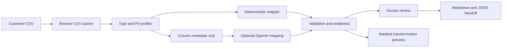

# FieldMap

Customer data onboarding copilot for forward-deployed engineering.

FieldMap turns a messy customer CSV into a reviewed CRM mapping plan. It profiles source columns, suggests canonical destinations, previews safe transformations, detects PII, scores import readiness, and exports an implementation handoff.

The demo runs without an API key. CSV rows stay in the browser. The optional live model route sends column names and inferred types only, never raw row values.

## Why This Project

Customer onboarding often fails in the last mile: field names differ, dates use incompatible formats, identifiers collide, and PII handling is unclear. FDE teams need a repeatable path from a customer file to a reviewed integration plan.

FieldMap demonstrates that path:

- CSV ingestion with quoted-field support.
- Type inference and canonical CRM mapping.
- Deterministic transformations with a visible preview.
- PII detection before customer data enters downstream systems.
- Required-field, uniqueness, email, and mapping validation.
- Human approval and exportable Markdown or JSON plans.
- Golden-case mapping evaluation and focused tests.
- OpenAI-assisted mapping with a metadata-only privacy boundary.

## Product Walkthrough

1. Open the sample customer CSV.
2. Inspect inferred source types and PII flags.
3. Review or change each destination field.
4. Check the normalized preview.
5. Resolve readiness issues.
6. Approve the mapping.
7. Export the onboarding plan.

The sample intentionally contains one malformed email and one duplicate customer ID so the review workflow is visible.

## Run Locally

Requires Node.js 20 or newer.

```powershell
npm start
```

Open `http://127.0.0.1:4180`.

There are no runtime dependencies to install.

Verification:

```powershell
npm test
npm run eval
```

## Optional Live Model

Create `.env` from `.env.example`:

```text
OPENAI_API_KEY=your_key_here
OPENAI_MODEL=gpt-4.1-mini
PORT=4180
```

The server sends only:

- Source column names.
- Inferred data types.
- Canonical schema metadata.

It does not send sample values or raw CSV rows. Unknown destinations and invalid model output fall back to deterministic mapping.

## Architecture



The browser owns raw data. The server is optional and stateless.

## Evaluation

Current result from `npm run eval`:

| Metric | Result |
| --- | ---: |
| Canonical mapping cases | 8 |
| Top-1 field accuracy | 100% |
| Automated tests | 10/10 |
| Raw rows sent to live model | 0 |

The evaluation cases cover CRM, Salesforce-style, HubSpot-style, and Chinese headers.

See [Evaluation](docs/EVALUATION.md) for limits.

## Privacy And Safety

- Raw CSV parsing happens in the browser.
- Live model input is restricted to column metadata.
- Sample PII is masked in the interface and preview.
- Required fields and duplicate destinations block approval.
- Exports contain mappings and validation summaries, not raw records.
- API requests have a 32 KB limit and per-process rate limit.
- Static responses include CSP, frame denial, and path traversal protection.

## Project Map

```text
public/
  index.html             Workbench UI
  styles.css             Responsive operations design
  js/csv.js              CSV parser
  js/schema.js           Canonical schema and masking
  js/mapper.js           Profiling, mapping, transforms, validation
  js/sample-data.js      Synthetic customer file
  js/app.js              Review workflow and exports
src/
  server.js              Zero-dependency HTTP server
  provider.js            Optional metadata-only OpenAI adapter
evals/cases.json         Mapping evaluation set
scripts/evaluate.js      Accuracy gate
tests/                   Mapper and API tests
docs/                    Case study and interview material
```

## Tradeoffs

- Deterministic rules are inspectable and private, but they miss unusual semantic headers.
- The optional model improves unseen naming conventions but must stay behind validation.
- The browser keeps the demo private and simple, but a production workflow needs durable audit storage and tenant authentication.
- CSV is capped at 80 columns, 500 rows, and 2 MB for safe demo behavior.
- This is a portfolio demo using synthetic data, not a production CRM connector.

## Next Production Step

Connect the approved mapping plan to a reversible dry-run loader. Persist reviewer overrides as evaluation data. Add tenant-scoped schema versions and a quarantine path for invalid rows.

## Documentation

- [Case study](docs/CASE_STUDY.md)
- [Evaluation record](docs/EVALUATION.md)
- [Interview demo script](docs/DEMO_SCRIPT.md)
- [Chinese resume bullets](docs/RESUME_BULLETS_ZH.md)
